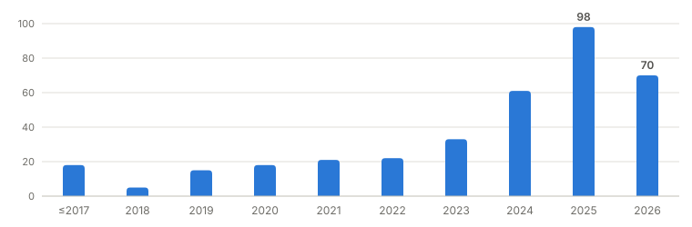

<!-- Generated by scripts/build_readme.py from benchmarks/*.yaml and taxonomy.yaml. Edit those files, not this one. -->

# Awesome Robotics Benchmarks

**A curated, domain-organized map of robotics benchmarks, summarized in concise, comparable tables.**

Manipulation · Dexterous hands · VLA evaluation · World models · Embodied reasoning · Navigation · Humanoids · Datasets · Simulators · HRI · Safety

    

This list covers **331 benchmarks and datasets and 30 simulators in 13 domains**, from the standard suites that most papers report on to small niche areas, in simulation and on real robots.

Each domain has its own page. Every entry there has a short description and its links (paper, website, code, data, leaderboard), and each sub-area ends with a comparison table: tasks, metrics, robots, sensing modalities, simulator and data. Domains run from the most widely used areas to the smaller ones; inside a sub-area, entries are in order of first release.

**New to the field?** Go to [Start here](#start-here). **Keeping up?** Go to [What's new](#whats-new).

## Browse by domain

| Domain | Sub-areas | Entries |
|---|---|---:|
| **[Manipulation](domains/manipulation.md)** | [Tabletop & Language-Conditioned](domains/manipulation.md#tabletop) · [Bimanual](domains/manipulation.md#bimanual) · [Mobile & Household](domains/manipulation.md#mobile) · [Assembly & Contact-Rich](domains/manipulation.md#contact-rich) · [Articulated Objects](domains/manipulation.md#articulated) · [Deformable Objects & Garments](domains/manipulation.md#deformable) · [Tactile](domains/manipulation.md#tactile) · [Grasping](domains/manipulation.md#grasping) | 64 |
| **[Dexterous Manipulation](domains/dexterous-manipulation.md)** | [In-Hand & Dexterous Skills](domains/dexterous-manipulation.md#dex-manipulation) · [Bimanual Dexterity](domains/dexterous-manipulation.md#dex-bimanual) · [Dexterous Grasping](domains/dexterous-manipulation.md#dex-grasping) · [Human Hand-Object Data](domains/dexterous-manipulation.md#hand-object-data) | 41 |
| **[Generalist Policies & VLA Evaluation](domains/vla-evaluation.md)** | [Multi-Domain Suites](domains/vla-evaluation.md#multi-domain) · [Real-World Evaluation](domains/vla-evaluation.md#real-eval) · [Real-to-Sim Evaluation](domains/vla-evaluation.md#real2sim) · [Generalization, Robustness & Memory Probes](domains/vla-evaluation.md#probes) | 27 |
| **[World Models & World-Action Models](domains/world-models.md)** | [Embodied World Models](domains/world-models.md#wm-embodied) · [Policy Evaluation with World Models & WAM Benchmarks](domains/world-models.md#wm-policy-eval) · [Physical Plausibility of Generated Video](domains/world-models.md#wm-physics) | 26 |
| **[Embodied Reasoning](domains/embodied-reasoning.md)** | [Spatial & Physical Reasoning](domains/embodied-reasoning.md#spatial) · [Task Planning & Agents](domains/embodied-reasoning.md#planning) · [Embodied Question Answering](domains/embodied-reasoning.md#eqa) | 24 |
| **[Navigation](domains/navigation.md)** | [Point, Object & Image-Goal Navigation](domains/navigation.md#goal-nav) · [Vision-Language Navigation (VLN)](domains/navigation.md#vln) · [Interactive Instruction Following](domains/navigation.md#interactive) · [Social Navigation](domains/navigation.md#social) · [Outdoor, Urban & Aerial](domains/navigation.md#outdoor) | 35 |
| **[Locomotion & Humanoids](domains/locomotion-humanoids.md)** | [Classic Continuous Control](domains/locomotion-humanoids.md#continuous-control) · [Legged Locomotion](domains/locomotion-humanoids.md#legged) · [Humanoid & Whole-Body Control](domains/locomotion-humanoids.md#humanoid) · [Motion Data for Humanoids](domains/locomotion-humanoids.md#motion-data) | 28 |
| **[Robot Learning Datasets](domains/datasets.md)** | [Robot Datasets](domains/datasets.md#robot-data) · [Egocentric & Human Data](domains/datasets.md#human-data) | 32 |
| **[Simulators](domains/simulators.md)** | [Physics Engines & General Simulators](domains/simulators.md#physics) · [Robot-Learning Frameworks](domains/simulators.md#learning-framework) · [Embodied-AI Platforms](domains/simulators.md#embodied-platform) · [Specialized Simulators](domains/simulators.md#specialized) | 30 |
| **[Human-Robot Interaction](domains/hri.md)** | [Assistive & Physical HRI](domains/hri.md#assistive) · [Handover](domains/hri.md#handover) · [Human-Robot Collaboration](domains/hri.md#collaboration) | 11 |
| **[Safety](domains/safety.md)** | [Safe RL & Control](domains/safety.md#safe-rl) · [Safety of LLM / VLA Agents](domains/safety.md#embodied-safety) | 16 |
| **[Autonomous Driving](domains/autonomous-driving.md)** | [Datasets & Open-Loop Benchmarks](domains/autonomous-driving.md#driving-data) · [Closed-Loop Simulation](domains/autonomous-driving.md#driving-closed-loop) | 11 |
| **[Other Areas](domains/other-areas.md)** | [Offline RL & Data-Driven Control](domains/other-areas.md#offline-rl) · [Aerial Robotics](domains/other-areas.md#aerial) · [Multi-Robot](domains/other-areas.md#multi-robot) · [Competitions](domains/other-areas.md#competition) | 16 |

Also on this page: [Start here](#start-here) · [What's new](#whats-new) · [How to read the pages](#how-to-read-this-list) · [Contributing](#contributing)

## Start here

The benchmarks that a large share of papers in each area report on. If you are choosing where to evaluate, these are the ones reviewers will expect.

| Domain | Most widely used |
|---|---|
| [Manipulation](domains/manipulation.md) | **Tabletop & Language-Conditioned:** [RLBench](domains/manipulation.md#rlbench) · [Meta-World](domains/manipulation.md#meta-world) · [Franka Kitchen](domains/manipulation.md#franka-kitchen) · [robomimic](domains/manipulation.md#robomimic) · [CALVIN](domains/manipulation.md#calvin) · [LIBERO](domains/manipulation.md#libero) **Bimanual:** [RoboTwin 2.0](domains/manipulation.md#robotwin-2-0) **Mobile & Household:** [RoboCasa](domains/manipulation.md#robocasa) **Assembly & Contact-Rich:** [NIST Assembly Task Boards](domains/manipulation.md#nist-assembly-task-boards) **Articulated Objects:** [PartNet-Mobility](domains/manipulation.md#partnet-mobility-sapien) **Deformable Objects & Garments:** [SoftGym](domains/manipulation.md#softgym) **Grasping:** [YCB Object and Model Set](domains/manipulation.md#ycb-object-and-model-set) · [GraspNet-1Billion](domains/manipulation.md#graspnet-1billion) |
| [Dexterous Manipulation](domains/dexterous-manipulation.md) | **In-Hand & Dexterous Skills:** [Adroit Hand](domains/dexterous-manipulation.md#adroit-hand-dapg) · [Shadow Dexterous Hand](domains/dexterous-manipulation.md#shadow-dexterous-hand-gymnasium-robotics) **Bimanual Dexterity:** [Bi-DexHands](domains/dexterous-manipulation.md#bi-dexhands) **Dexterous Grasping:** [DexGraspNet](domains/dexterous-manipulation.md#dexgraspnet) **Human Hand-Object Data:** [HO-3D](domains/dexterous-manipulation.md#ho-3d) · [GRAB](domains/dexterous-manipulation.md#grab) · [DexYCB](domains/dexterous-manipulation.md#dexycb) · [ARCTIC](domains/dexterous-manipulation.md#arctic) |
| [Generalist Policies & VLA Evaluation](domains/vla-evaluation.md) | **Multi-Domain Suites:** [ManiSkill](domains/vla-evaluation.md#maniskill) **Real-to-Sim Evaluation:** [SimplerEnv](domains/vla-evaluation.md#simplerenv-simpler) |
| [World Models & World-Action Models](domains/world-models.md) | **Physical Plausibility of Generated Video:** [PhyGenBench](domains/world-models.md#phygenbench) · [Physics-IQ](domains/world-models.md#physics-iq) · [VideoPhy-2](domains/world-models.md#videophy-2) *No embodied world-model benchmark is a settled standard yet; these are the common physical-plausibility tests for video generators.* |
| [Embodied Reasoning](domains/embodied-reasoning.md) | **Spatial & Physical Reasoning:** [VSI-Bench](domains/embodied-reasoning.md#vsi-bench) · [ERQA](domains/embodied-reasoning.md#erqa-gemini-robotics) **Task Planning & Agents:** [ALFWorld](domains/embodied-reasoning.md#alfworld) **Embodied Question Answering:** [OpenEQA](domains/embodied-reasoning.md#openeqa) |
| [Navigation](domains/navigation.md) | **Point, Object & Image-Goal Navigation:** [AI2-THOR](domains/navigation.md#ai2-thor) · [Habitat Navigation Challenge](domains/navigation.md#habitat-navigation-challenge-pointnav-objectnav-imagenav) **Vision-Language Navigation (VLN):** [R2R](domains/navigation.md#r2r-room-to-room) · [VLN-CE](domains/navigation.md#vln-ce-vision-and-language-navigation-in-continuous-environments) · [RxR](domains/navigation.md#rxr-room-across-room) **Interactive Instruction Following:** [ALFRED](domains/navigation.md#alfred) |
| [Locomotion & Humanoids](domains/locomotion-humanoids.md) | **Classic Continuous Control:** [Gymnasium MuJoCo](domains/locomotion-humanoids.md#gymnasium-mujoco-openai-gym) · [DeepMind Control Suite](domains/locomotion-humanoids.md#deepmind-control-suite) **Legged Locomotion:** [legged_gym](domains/locomotion-humanoids.md#legged-gym) **Motion Data for Humanoids:** [AMASS](domains/locomotion-humanoids.md#amass) · [LAFAN1](domains/locomotion-humanoids.md#lafan1) |
| [Robot Learning Datasets](domains/datasets.md) | **Robot Datasets:** [RT-1 Robot Action](domains/datasets.md#rt-1-robot-action-fractal) · [BridgeData V2](domains/datasets.md#bridgedata-v2) · [Open X-Embodiment](domains/datasets.md#open-x-embodiment) · [DROID](domains/datasets.md#droid) · [AgiBot World](domains/datasets.md#agibot-world) **Egocentric & Human Data:** [EPIC-KITCHENS-100](domains/datasets.md#epic-kitchens-100) · [Ego4D](domains/datasets.md#ego4d) |
| [Simulators](domains/simulators.md) | **Physics Engines & General Simulators:** [Gazebo](domains/simulators.md#gazebo) · [MuJoCo](domains/simulators.md#mujoco) · [PyBullet](domains/simulators.md#pybullet) · [Isaac Sim](domains/simulators.md#isaac-sim) · [Isaac Gym](domains/simulators.md#isaac-gym) **Robot-Learning Frameworks:** [Isaac Lab](domains/simulators.md#isaac-lab) **Embodied-AI Platforms:** [Habitat-Sim](domains/simulators.md#habitat-sim) |
| [Human-Robot Interaction](domains/hri.md) | **Assistive & Physical HRI:** [Assistive Gym](domains/hri.md#assistive-gym) **Human-Robot Collaboration:** [Overcooked-AI](domains/hri.md#overcooked-ai) |
| [Safety](domains/safety.md) | **Safe RL & Control:** [Safety Gym](domains/safety.md#safety-gym) · [Safety-Gymnasium](domains/safety.md#safety-gymnasium) |
| [Autonomous Driving](domains/autonomous-driving.md) | **Datasets & Open-Loop Benchmarks:** [KITTI](domains/autonomous-driving.md#kitti) · [nuScenes](domains/autonomous-driving.md#nuscenes) · [Waymo Open Dataset](domains/autonomous-driving.md#waymo-open-dataset) **Closed-Loop Simulation:** [CARLA](domains/autonomous-driving.md#carla) |
| [Other Areas](domains/other-areas.md) | **Offline RL & Data-Driven Control:** [D4RL](domains/other-areas.md#d4rl) |

## What's new

First released since Nov 2025 (the last 12 months), newest first.

<picture>
  <source media="(prefers-color-scheme: dark)" srcset="assets/entries-by-year-dark.svg">
  
</picture>
 
<em>Entries in this list by year of first release. 2026 is the year so far.</em>

- **[Manipulation](domains/manipulation.md):** [ContactBench 1.0](domains/manipulation.md#contactbench-1-0) (Oct 2026) · [SoftVTBench](domains/manipulation.md#softvtbench) (Jul 2026) · [EBench](domains/manipulation.md#ebench) (Jun 2026) · [DuoBench](domains/manipulation.md#duobench) (Jun 2026) · [Tabero](domains/manipulation.md#tabero) (May 2026) · [LeHome](domains/manipulation.md#lehome) (Apr 2026) · [BiCoord](domains/manipulation.md#bicoord) (Apr 2026) · [RoboCasa365](domains/manipulation.md#robocasa365) (Mar 2026) · [MolmoSpaces](domains/manipulation.md#molmospaces) (Feb 2026) · [UniVTAC](domains/manipulation.md#univtac) (Feb 2026) · [RoboBenchMart](domains/manipulation.md#robobenchmart) (Nov 2025) · [RoCo Challenge](domains/manipulation.md#roco-challenge) (Nov 2025)
- **[Dexterous Manipulation](domains/dexterous-manipulation.md):** [HandsOn](domains/dexterous-manipulation.md#handson) (Oct 2026) · [BiDex-100](domains/dexterous-manipulation.md#bidex-100) (Oct 2026) · [V2D Challenge](domains/dexterous-manipulation.md#v2d-challenge-video-to-data) (Sep 2026) · [Bench2Dex](domains/dexterous-manipulation.md#bench2dex) (Sep 2026) · [DexVerse](domains/dexterous-manipulation.md#dexverse) (Jul 2026) · [DexJoCo](domains/dexterous-manipulation.md#dexjoco) (May 2026) · [HRDexDB](domains/dexterous-manipulation.md#hrdexdb) (Apr 2026) · [POMDAR](domains/dexterous-manipulation.md#pomdar) (Apr 2026)
- **[Generalist Policies & VLA Evaluation](domains/vla-evaluation.md):** [X2Real](domains/vla-evaluation.md#x2real) (Sep 2026) · [RoboDojo](domains/vla-evaluation.md#robodojo) (Jul 2026) · [Colosseum V2](domains/vla-evaluation.md#colosseum-v2) (May 2026) · [RoboLab](domains/vla-evaluation.md#robolab) (Apr 2026) · [ManipArena](domains/vla-evaluation.md#maniparena) (Mar 2026) · [LIBERO-Para](domains/vla-evaluation.md#libero-para) (Mar 2026) · [vla-eval](domains/vla-evaluation.md#vla-eval) (Mar 2026) · [RoboMME](domains/vla-evaluation.md#robomme) (Mar 2026) · [ManipulationNet](domains/vla-evaluation.md#manipulationnet) (Mar 2026) · [VLA-Arena](domains/vla-evaluation.md#vla-arena) (Dec 2025) · [REALM](domains/vla-evaluation.md#realm) (Dec 2025) · [PolaRiS](domains/vla-evaluation.md#polaris) (Dec 2025)
- **[World Models & World-Action Models](domains/world-models.md):** [WorldFailBench](domains/world-models.md#worldfailbench) (Oct 2026) · [WorldOracle](domains/world-models.md#worldoracle) (Oct 2026) · [RoboTwin-Phys](domains/world-models.md#robotwin-phys) (Sep 2026) · [WMBench](domains/world-models.md#wmbench) (Jul 2026) · [RoboWM-Bench](domains/world-models.md#robowm-bench) (Apr 2026) · [WR-Arena](domains/world-models.md#wr-arena) (Mar 2026) · [RoboTwin 2.0-Plus](domains/world-models.md#robotwin-2-0-plus) (Mar 2026) · [WorldArena](domains/world-models.md#worldarena) (Feb 2026) · [RBench](domains/world-models.md#rbench) (Jan 2026) · [WoW-World-Eval](domains/world-models.md#wow-world-eval) (Jan 2026) · [PAI-Bench](domains/world-models.md#pai-bench) (Dec 2025)
- **[Embodied Reasoning](domains/embodied-reasoning.md):** [Embodied First Exam](domains/embodied-reasoning.md#embodied-first-exam) (Nov 2026) · [BEHAVIOR-Spatial](domains/embodied-reasoning.md#behavior-spatial) (Oct 2026) · [ESI-Bench](domains/embodied-reasoning.md#esi-bench) (May 2026) · [CaP-X](domains/embodied-reasoning.md#cap-x) (Mar 2026) · [RoboReward](domains/embodied-reasoning.md#roboreward) (Jan 2026)
- **[Navigation](domains/navigation.md):** [SidewalkBench](domains/navigation.md#sidewalkbench) (Jun 2026) · [OmniNavBench](domains/navigation.md#omninavbench) (May 2026) · [LangMap](domains/navigation.md#langmap) (Feb 2026) · [VLNVerse](domains/navigation.md#vlnverse) (Dec 2025)
- **[Locomotion & Humanoids](domains/locomotion-humanoids.md):** [LocoManiLab](domains/locomotion-humanoids.md#locomanilab) (Oct 2026) · [HiPHI](domains/locomotion-humanoids.md#hiphi) (Aug 2026) · [HumanTracker](domains/locomotion-humanoids.md#humantracker) (Aug 2026) · [HumanoidArena](domains/locomotion-humanoids.md#humanoidarena) (Jun 2026) · [SIMPLE](domains/locomotion-humanoids.md#simple) (Jun 2026) · [BONES-SEED](domains/locomotion-humanoids.md#bones-seed) (Mar 2026) · [RoboGauge](domains/locomotion-humanoids.md#robogauge) (Jan 2026)
- **[Robot Learning Datasets](domains/datasets.md):** [FineART](domains/datasets.md#fineart) (Sep 2026) · [TacVerse](domains/datasets.md#tacverse) (Sep 2026) · [HiFi-UMI-2K](domains/datasets.md#hifi-umi-2k) (Jul 2026) · [ABC-130K](domains/datasets.md#abc-130k) (Jun 2026) · [HIW-500](domains/datasets.md#hiw-500) (Jun 2026) · [HumanNet](domains/datasets.md#humannet) (May 2026) · [Open-H-Embodiment](domains/datasets.md#open-h-embodiment) (Apr 2026) · [EgoVerse](domains/datasets.md#egoverse) (Apr 2026) · [AgiBot World 2026](domains/datasets.md#agibot-world-2026) (Apr 2026) · [10Kh RealOmni](domains/datasets.md#10kh-realomni) (Dec 2025) · [RoboCOIN](domains/datasets.md#robocoin) (Nov 2025) · [Egocentric-10K](domains/datasets.md#egocentric-10k) (Nov 2025)
- **[Simulators](domains/simulators.md):** [GS-Playground](domains/simulators.md#gs-playground) (Apr 2026) · [CARLA-Air](domains/simulators.md#carla-air) (Mar 2026) · [Isaac Lab-Arena](domains/simulators.md#isaac-lab-arena) (Dec 2025)
- **[Human-Robot Interaction](domains/hri.md):** [HABIT](domains/hri.md#habit) (Jun 2026) · [OpenRoboCare](domains/hri.md#openrobocare) (Nov 2025)
- **[Safety](domains/safety.md):** [ManiGuard](domains/safety.md#maniguard) (Aug 2026) · [LIBERO-Safety](domains/safety.md#libero-safety) (Jun 2026) · [CRAX](domains/safety.md#crax) (Jun 2026) · [TouchSafeBench](domains/safety.md#touchsafebench) (May 2026) · [RoboJailBench](domains/safety.md#robojailbench) (May 2026)
- **[Autonomous Driving](domains/autonomous-driving.md):** [nuReasoning](domains/autonomous-driving.md#nureasoning) (May 2026)

## How to read the pages

Every entry has the same shape:

> **Name** (year of first release) `Sim` `widely used` `new`: what it evaluates and what sets it apart. 
> *Resources*: Paper (venue) | Website | Code ★stars | Data | Leaderboard

- `Sim`, `Real`, `Sim + Real`: where the evaluation runs.
- `widely used`: a de-facto standard of its sub-area. Its name is bold in the tables.
- `new`: first released in the last 12 months.
- ★: GitHub stars of the code repository, as of 2026-11-21.

Each sub-area ends with a **summary comparison** table, one row per entry. Click a name in a table to jump to its description.

<b>What the table columns mean</b>

- **Subtype**: short tags for what sets the benchmark apart.
- **Task Count, Metric Count, Robot Configs**: recorded as numbers, with the names in brackets when they are short. Longer details are in the description and in the entry's YAML file.
- **Modality**: what the benchmark provides as observations (RGB, depth, point cloud, proprioception, language, tactile, ...).
- **SIM**: the simulator backend (for example MuJoCo, SAPIEN, Isaac Sim). "Real world" means the benchmark runs on real hardware or real recordings only; "+ real" means it has both a simulated and a real-world part.
- **Data Source**: how the trajectories or labels that ship with the benchmark were collected.
  - *Human demos* (human demonstration): recorded from a person controlling the robot or simulator (teleoperation, VR, kinesthetic teaching) or from human motion capture.
  - *Human labels* (human annotation): people wrote the questions or labels over existing sensor data.
  - *Planner* (motion planner): generated by a planner, inverse kinematics, a trajectory optimizer or a scripted expert.
  - *Synthetic*: generated programmatically or by generative models, with no physics-aware planner and no human.
  - *RL policy*: rollouts of trained reinforcement-learning policies.
  - *Mixed*: more than one of the above. A dash means the benchmark ships no data.
- **Data Size**: what ships with the benchmark.
- On the **Simulators** page the table compares capabilities instead: physics engine, renderer, GPU support (✓ only when the physics itself runs on the GPU for parallel environments), operating systems and license.

**Abbreviations**: VLA, vision-language-action model. VLN, vision-language navigation. WAM, world-action model (a policy that predicts future observations together with actions). EQA, embodied question answering. HRI, human-robot interaction.

## Contributing

Additions and corrections are both welcome.

This README and the domain pages are generated. Each entry is one YAML file in [`benchmarks/`](benchmarks/), the domains and sub-areas come from [`taxonomy.yaml`](taxonomy.yaml), and [`scripts/build_readme.py`](scripts/build_readme.py) writes the pages. To add or fix an entry, edit the YAML file and rebuild; do not edit the generated pages by hand. [CONTRIBUTING.md](CONTRIBUTING.md) has the template and the steps.

Found a wrong number or a dead link? Open an issue or a pull request with the source.
